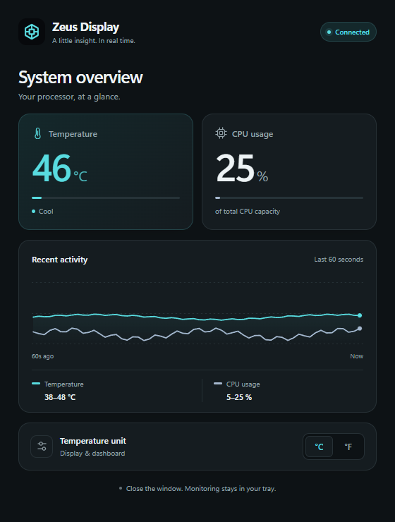

# Zeus Display


A Windows tray app for compatible Zeus cooler displays, with live CPU temperature and usage, an elegant dashboard, and automatic USB reconnection.



## Features

- Live CPU temperature and processor usage on your cooler's display.
- A compact dashboard with a 60-second activity chart and Windows light/dark theme support.
- Celsius or Fahrenheit, saved between sessions and applied to both displays.
- System tray operation: close the dashboard to keep monitoring; double-click the tray icon to reopen it.
- Automatic USB reconnection and recovery after sleep.
- Optional startup at Windows sign-in, enabled by default in setup.

## Compatibility

- Windows 10 22H2 or Windows 11, x64, with an administrator account.
- A compatible USB HID cooler display with vendor ID `5131` and product ID `2007`.
- [PawnIO](https://pawnio.eu/), installed separately, for CPU temperature sensor access.

Hardware support depends on the CPU sensors exposed by LibreHardwareMonitor. This app targets the USB device above; it does not support every cooler display. Close the vendor's monitoring app before running Zeus Display so that both apps do not compete for the device.

## Install

1. Open this repository's **Releases** page and download `ZeusDisplay-<version>-win-x64-Setup.exe`.
2. Install [PawnIO](https://pawnio.eu/) from its official site. **The Zeus Display installer does not install PawnIO.**
3. Run Zeus Display setup and approve the administrator prompt. Setup bundles .NET and installs Microsoft's WebView2 Runtime if it is missing. An internet connection is required only if WebView2 needs installation.
4. Leave **Start Zeus Display when I sign in to Windows** checked to enable startup.
5. Connect the cooler's USB cable and launch Zeus Display.

Setup creates a Start menu shortcut and an uninstaller. A desktop shortcut is optional. Startup runs silently in the tray, about 10 seconds after the account that ran setup signs in. It uses a Windows scheduled task with elevated privileges, so hardware sensors can be read without a new UAC prompt on every sign-in. Use your normal Windows administrator account when installing; supplying a different administrator's credentials associates startup with that account.

To change startup behavior, rerun setup and change its startup checkbox, or disable the **ZeusDisplay** task in Windows Task Scheduler. To quit completely, right-click the tray icon and choose **Exit**. Uninstall through Windows **Installed apps**; uninstall also removes the startup task. Your saved temperature preference is kept in `%APPDATA%\ZeusDisplay\settings.json`.

Release installers are currently unsigned. GitHub also provides `SHA256SUMS.txt` beside each installer for checking the downloaded file's SHA-256 hash:

```powershell
Get-FileHash .\ZeusDisplay-1.0.0-win-x64-Setup.exe -Algorithm SHA256
```

## Build from source

Install the [.NET 10 SDK](https://dotnet.microsoft.com/download/dotnet/10.0) on Windows, then run:

```powershell
dotnet build ZeusDisplay.csproj --configuration Release
```

Launch `bin\Release\net10.0-windows\ZeusDisplay.exe` and approve elevation. Local development builds require the .NET 10 Desktop Runtime and [WebView2 Runtime](https://developer.microsoft.com/microsoft-edge/webview2/). Release setup bundles .NET and handles WebView2 automatically.

To build the release installer, also install [Inno Setup 6.3 or later](https://jrsoftware.org/isdl.php), then run:

```powershell
.\scripts\Build-Release.ps1 -Version 1.0.0
```

The build script publishes a self-contained `win-x64` app, downloads and verifies Microsoft's signed WebView2 bootstrapper, compiles the installer, and writes the setup EXE and checksum file to `artifacts\release`. It does not install the app or register startup on the build machine. To use a compiler in a custom location:

```powershell
.\scripts\Build-Release.ps1 -Version 1.0.0 -InnoCompiler 'C:\Tools\Inno Setup\ISCC.exe'
```

## GitHub Actions and releases

The [build workflow](.github/workflows/build.yml) runs on pushes, pull requests, and manual dispatch. It checks dashboard behavior in headless Edge, builds the app and installer on Windows, validates the startup task definition, and tests silent install, disabling startup, and uninstall on the hosted Windows runner. Successful builds upload the setup files as an Actions artifact; failed installer checks upload their logs.

To publish a release, push a version tag after committing these files to GitHub:

```powershell
git tag v1.0.0
git push origin v1.0.0
```

Tags must use `vMAJOR.MINOR.PATCH`. After the build succeeds, the workflow creates the GitHub Release and attaches the setup EXE and `SHA256SUMS.txt`. If the release already exists, it uploads the files to that release instead. Branch builds and manual runs produce downloadable Actions artifacts without publishing a release. The workflow uses GitHub's built-in `GITHUB_TOKEN`; no personal access token is required. Repository or organization policies must allow GitHub Actions and release creation.

## Troubleshooting

| Issue | What to check |
| --- | --- |
| Display is not connected | Check the USB cable, close the vendor app, and confirm the USB IDs are `5131:2007`. The app retries automatically. |
| Temperature is unavailable | Install PawnIO separately, restart Zeus Display as administrator, and check that your CPU is supported by LibreHardwareMonitor. |
| Dashboard cannot open | Repair or install Microsoft's Evergreen WebView2 Runtime, or rerun setup with an internet connection. |
| App does not start with Windows | Confirm the **ZeusDisplay** scheduled task is enabled and that you are signing in to the same account that ran setup. |
| Setup asks to close Zeus Display | Exit through the tray menu before upgrading or uninstalling. Closing the window only hides the dashboard. |

## Built with

[.NET / Windows Forms](https://dotnet.microsoft.com/), [WebView2](https://developer.microsoft.com/microsoft-edge/webview2/), [LibreHardwareMonitor](https://github.com/LibreHardwareMonitor/LibreHardwareMonitor), [HidSharp](https://github.com/IntergatedCircuits/HidSharp), and [Inno Setup](https://jrsoftware.org/isinfo.php). These projects and PawnIO have their own licenses.
